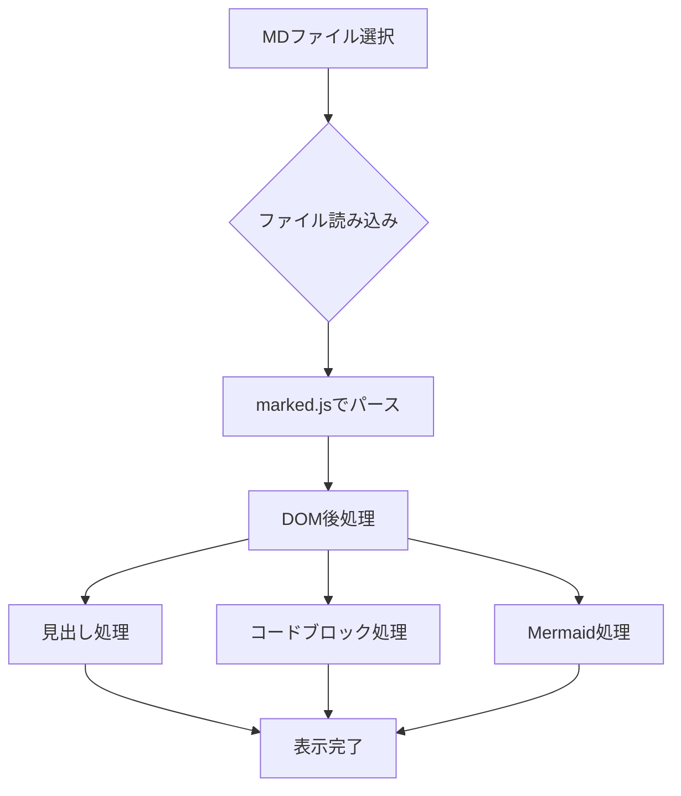
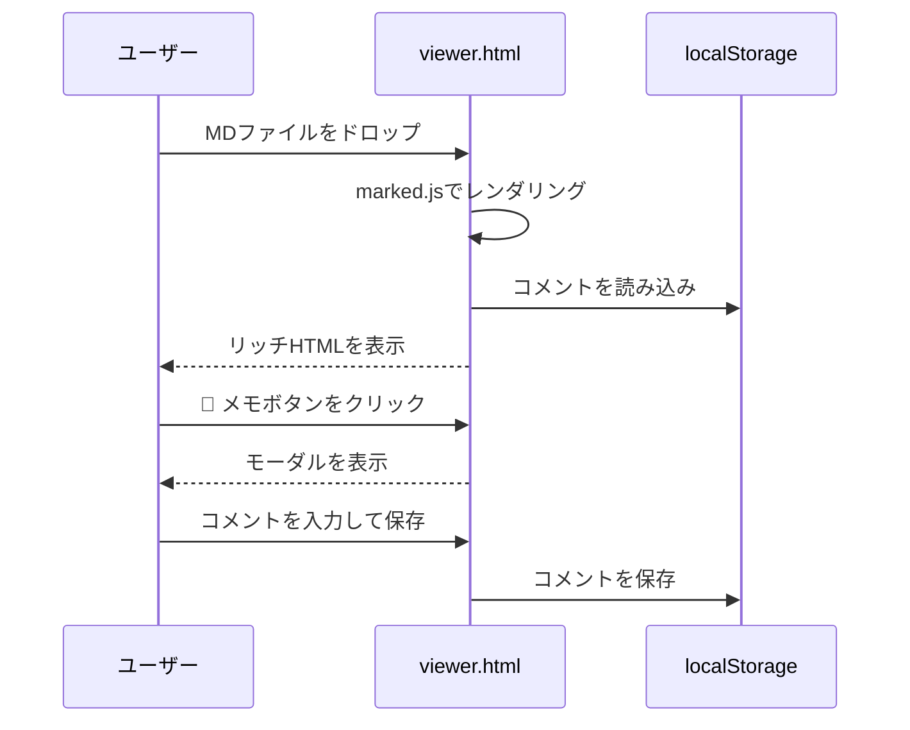

# MD Rich Viewer — 動作確認サンプル

これは `viewer.html` の動作確認用サンプルです。

## 見出しとTOC

サイドバーにH1〜H3が目次として表示されます。スクロールするとアクティブな見出しがハイライトされます。

### 第3レベル見出し

見出し右の 🔗 をクリックするとURLをコピーできます。  
💬 メモ ボタンでこのセクションへのコメントを残せます。

## テキスト装飾

**太字**、*斜体*、~~打ち消し~~、`インラインコード`

> ブロッククォート  
> 複数行も対応

---

## テーブル

| 言語 | 種類 | 特徴 |
|------|------|------|
| Python | 汎用 | 読みやすい構文 |
| JavaScript | Web | ブラウザネイティブ |
| Rust | システム | メモリ安全 |

## タスクリスト

- [x] ドラッグ&ドロップ対応
- [x] TOC自動生成
- [x] シンタックスハイライト
- [x] Mermaidダイアグラム
- [x] コメント機能
- [ ] 追加機能（あれば）

## コードブロック

```python
def greet(name: str) -> str:
    return f"Hello, {name}!"

for person in ["Alice", "Bob", "Charlie"]:
    print(greet(person))
```

```javascript
const fetchData = async (url) => {
  const res = await fetch(url);
  const data = await res.json();
  return data;
};
```

```bash
npx serve viewer.html
```

## Mermaidダイアグラム

### フローチャート



### シーケンス図



## 画像

画像はローカルファイルも表示できます（File API経由）。

## リンク

- [GitHub](https://github.com)
- [marked.js](https://marked.js.org)
- [highlight.js](https://highlightjs.org)
- [Mermaid](https://mermaid.js.org)

## 長いセクション（スクロールテスト用）

Lorem ipsum dolor sit amet, consectetur adipiscing elit. Sed do eiusmod tempor incididunt ut labore et dolore magna aliqua.

Ut enim ad minim veniam, quis nostrud exercitation ullamco laboris nisi ut aliquip ex ea commodo consequat.

Duis aute irure dolor in reprehenderit in voluptate velit esse cillum dolore eu fugiat nulla pariatur.

Excepteur sint occaecat cupidatat non proident, sunt in culpa qui officia deserunt mollit anim id est laborum.

### サブセクション A

内容A

### サブセクション B

内容B

### サブセクション C

内容C（TOCスクロールテスト用）
